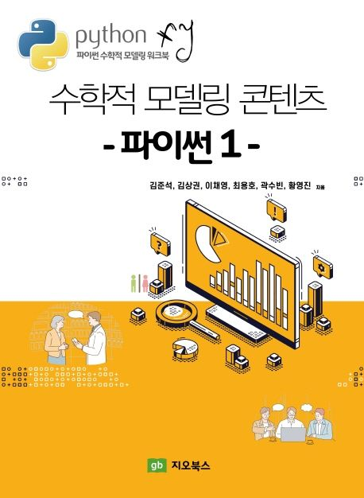

# Publications (update: 2026.11.11)

##### ORCID: [0000-0002-8495-819X](https://orcid.org/0000-0002-8495-819X), [0009-0004-1902-6507](https://orcid.org/0009-0004-1902-6507)
SCIE/SSCI: 45, ESCI/KCI: 4, Book: 21

## Thesis
M.S.(2019) [**<u> Numerical simulation of the fluid flow on stairs.</u>**](https://ksk8863.github.io/ksk8863/publications/) 
Ph.D.(2021) [**<u> Numerical analysis and simulation of partial differential equation in various fields.</u>**](https://ksk8863.github.io/ksk8863/publications/)

## Published or Accepted Papers
### SCIE/SSCI
  1. [**<u> Reconstruction of the time-dependent volatility function using the Black-Scholes model.</u>**](https://doi.org/10.1155/2018/3093708) Yuzi Jin, Jian Wang, **Sangkwon Kim**, Youngjin Heo, Changwoo Yoo, Youngrock Kim, Junseok Kim, and Darae Jeong, *Discrete Dynamics in Nature and Society (Discrete Dyn. Nat. Soc.)*, 2018, 3093708, 2018.05.07. ISSN 1026-0226, EISSN 1607-887X. JCR 2016 (SCIE): IF 0.711, Q3 (44/64). **JCR 2025 (SCIE): IF 1.4, Q3 (75/141).** [**<u> PDF </u>**](https://github.com/ksk8863/ksk8863/raw/master/publications/paper_PDF/Reconstruction%20of%20the%20Time-Dependent%20Volatility%20Function%20Using%20the%20Black-Scholes%20Model.pdf)
  2. [**<u> Fast Monte-Carlo simulation for equity-linked securities.</u>**](https://doi.org/10.1007/s10614-019-09947-2) Hanbyeol Jang, **Sangkwon Kim**, Junhee Han, Seongjin Lee, Jungyup Ban, Hyunsoo Han, Chaeyoung Lee, Darae Jeong, and Junseok Kim, *Computational Economics (Comput. Econ.)*, 56(4), 865-882, 2019.11.11. ISSN 0927-7099, EISSN 1572-9974. JCR 2018 (SSCI): IF 1.185, Q3 (187/363). **JCR 2025 (SSCI): IF 2.1, Q2 (229/627).** [**<u> PDF </u>**](https://github.com/ksk8863/ksk8863/raw/master/publications/paper_PDF/Fast%20Monte-Carlo%20simulation%20for%20equity-linked%20securities.pdf)
  3. [**<u> Mathematical modeling and computer simulation of the three-dimensional pattern formation of honeycombs.</u>**](https://doi.org/10.1038/s41598-019-56942-6) Darae Jeong, Yibao Li, **Sangkwon Kim**, Yongho Choi, Chaeyoung Lee, and Junseok Kim, *Scientific Reports (Sci. Rep.)*, 9(1), 20364, 2019.12.30. EISSN 2045-2322. JCR 2018 (SCIE): IF 4.011, Q1 (15/69). **JCR 2025 (SCIE): IF 4.9, Q1 (21/141).** [**<u> PDF </u>**](https://github.com/ksk8863/ksk8863/raw/master/publications/paper_PDF/Mathematical%20modeling%20and%20simulation%20for%203D%20pattern%20formation%20of%20honeycombs.pdf)
  4. [**<u> Super-fast computation for the three-asset equity-linked securities using finite difference method.</u>**](https://doi.org/10.3390/math8030307) Chaeyoung Lee, Jisang Lyu, Eunchae Park, Wonjin Lee, **Sangkwon Kim**, Darae Jeong, and Junseok Kim, *Mathematics*, 8(3), 307, 2020.02.26. EISSN 2227-7390. JCR 2018 (SCIE): IF 1.105, Q1 (75/314). **JCR 2025 (SCIE): IF 2.3, Q1 (29/499).** [**<u> PDF </u>**](https://github.com/ksk8863/ksk8863/raw/master/publications/paper_PDF/Super-fast%20computation%20for%20the%20three-asset%20equity-linked%20securities%20using%20finite%20difference%20method.pdf)
  5. [**<u> Finite difference method for the multi-asset Black-Scholes equations.</u>**](https://doi.org/10.3390/math8030391) **Sangkwon Kim**, Darae Jeong, Chaeyoung Lee, and Junseok Kim, *Mathematics*, 8(3), 391, 2020.03.10. EISSN 2227-7390. JCR 2018 (SCIE): IF 1.105, Q1 (75/314). **JCR 2025 (SCIE): IF 2.3, Q1 (29/499).** [**<u> PDF </u>**](https://github.com/ksk8863/ksk8863/raw/master/publications/paper_PDF/Finite%20difference%20method%20for%20the%20multi-asset%20Black-Scholes%20equations.pdf)
  6. [**<u> Shape transformation using the modified Allen-Cahn equation.</u>**](https://doi.org/10.1016/j.aml.2020.106487) Hyundong Kim, Sungha Yoon, Jian Wang, Chaeyoung Lee, **Sangkwon Kim**, Jintae Park, and Junseok Kim, *Applied Mathematics Letters (Appl. Math. Lett.)*, 107, 106487, 2020.05.17. ISSN 0893-9659, EISSN 1873-5452. JCR 2018 (SCIE): IF 3.487, Q1 (9/254). **JCR 2025 (SCIE): IF 2.7, Q1 (33/347).** [**<u> PDF </u>**](https://github.com/ksk8863/ksk8863/raw/master/publications/paper_PDF/Shape%20transformation%20using%20the%20modified%20Allen-Cahn%20equation.pdf)
  7. [**<u> Phase-field modeling and computer simulation of the coffee-ring effect.</u>**](https://doi.org/10.1007/s00162-020-00544-w) Junxiang Yang, Hyundong Kim, Chaeyoung Lee, **Sangkwon Kim**, Jian Wang, Sungha Yoon, Jintae Park, and Junseok Kim, *Theoretical and Computational Fluid Dynamics (Theor. Comput. Fluid Dyn.)*, 34(5-6), 679-692, 2020.07.12. ISSN 0935-4964, EISSN 1432-2250. JCR 2019 (SCIE): IF 1.675, Q3 (20/34). **JCR 2025 (SCIE): IF 3.4, Q1 (10/43).** [**<u> PDF </u>**](https://github.com/ksk8863/ksk8863/raw/master/publications/paper_PDF/Phase-field%20modeling%20and%20computer%20simulation%20of%20the%20coffee-ring%20effect.pdf)
  8. [**<u> An accurate and practical explicit hybrid method for the Chan-Vese image segmentation model.</u>**](https://doi.org/10.3390/math8071173) Darae Jeong, **Sangkwon Kim**, Chaeyoung Lee, and Junseok Kim, *Mathematics*, 8(7), 1173, 2020.07.17. EISSN 2227-7390. JCR 2019 (SCIE): IF 1.747, Q1 (28/325). **JCR 2025 (SCIE): IF 2.3, Q1 (29/499).** [**<u> PDF </u>**](https://github.com/ksk8863/ksk8863/raw/master/publications/paper_PDF/An%20accurate%20and%20practical%20explicit%20hybrid%20method%20for%20the%20Chan-Vese%20image%20segmentation%20model.pdf)
  9. [**<u> Fourier-spectral method for the phase-field equations.</u>**](https://doi.org/10.3390/math8081385) Sungha Yoon, Darae Jeong, Chaeyoung Lee, Hyundong Kim, **Sangkwon Kim**, Hyun Geun Lee, and Junseok Kim, *Mathematics*, 8(8), 1385, 2020.08.18. EISSN 2227-7390. JCR 2019 (SCIE): IF 1.747, Q1 (28/325). **JCR 2025 (SCIE): IF 2.3, Q1 (29/499).** [**<u> PDF </u>**](https://github.com/ksk8863/ksk8863/raw/master/publications/paper_PDF/Fourier-spectral%20method%20for%20the%20phase-field%20equations.pdf)
  10. [**<u> Modeling and simulation of droplet evaporation using a modified Cahn-Hilliard equation.</u>**](https://doi.org/10.1016/j.amc.2020.125591) Hyun Geun Lee, Junxiang Yang, **Sangkwon Kim**, and Junseok Kim, *Applied Mathematics and Computation (Appl. Math. Comput.)*, 390, 125591, 2020.08.24. ISSN 0096-3003, EISSN 1873-5649. JCR 2019 (SCIE): IF 3.472, Q1 (7/261). **JCR 2025 (SCIE): IF 3.2, Q1 (15/347).** [**<u> PDF </u>**](https://github.com/ksk8863/ksk8863/raw/master/publications/paper_PDF/Modeling%20and%20simulation%20of%20droplet%20evaporation%20using%20a%20modified%20Cahn-Hilliard%20equation.pdf)
  11. [**<u> Periodic travelling wave solutions for a reaction-diffusion system on landscape fitted domains.</u>**](https://doi.org/10.1016/j.chaos.2020.110300) **Sangkwon Kim**, Jintae Park, Chaeyoung Lee, Darae Jeong, Yongho Choi, Soobin Kwak, and Junseok Kim, *Chaos, Solitons & Fractals (Chaos Solitons Fractals)*, 139, 110300, 2020.09.21. ISSN 0960-0779, EISSN 1873-2887. JCR 2019 (SCIE): IF 3.764, Q1 (2/55). **JCR 2025 (SCIE): IF 5.7, Q1 (1/61).** [**<u> PDF </u>**](https://github.com/ksk8863/ksk8863/raw/master/publications/paper_PDF/Periodic%20travelling%20wave%20solutions%20for%20a%20reaction-diffusion%20system%20on%20landscape%20fitted%20domains.pdf)
  12. [**<u> On the evolutionary dynamics of the Cahn-Hilliard equation with cut-off mass source.</u>**](https://doi.org/10.4208/nmtma.OA-2020-0051) Chaeyoung Lee, Hyundong Kim, Sungha Yoon, Jintae Park, **Sangkwon Kim**, Junxiang Yang, and Junseok Kim, *Numerical Mathematics: Theory, Methods and Applications (Numer. Math.-Theory Methods Appl.)*, 14(1), 242-260, 2020.10.09. ISSN 1004-8979, EISSN 2079-7338. JCR 2019 (SCIE): IF 1.659, Q1 (34/325). **JCR 2025 (SCIE): IF 1.1, Q2 (132/499).** [**<u> PDF </u>**](https://github.com/ksk8863/ksk8863/raw/master/publications/paper_PDF/On%20the%20evolutionary%20dynamics%20of%20the%20Cahn-Hilliard%20equation%20with%20cut-off%20mass%20source.pdf)
  13. [**<u> Automatic binary data classification using a modified Allen-Cahn equation.</u>**](https://doi.org/10.1142/S0218001421500130) **Sangkwon Kim** and Junseok Kim, *International Journal of Pattern Recognition and Artificial Intelligence (Int. J. Pattern Recognit. Artif. Intell.)*, 35(4), 2150013, 2020.10.22. ISSN 0218-0014, EISSN 1793-6381. JCR 2019 (SCIE): IF 1.375, Q4 (106/137). **JCR 2025 (SCIE): IF 0.9, Q4 (189/210).** [**<u> PDF </u>**](https://github.com/ksk8863/ksk8863/raw/master/publications/paper_PDF/Automatic%20Binary%20Data%20Classification%20Using%20A%20Modified%20Allen%E2%80%93Cahn%20Equation.pdf)
  14. [**<u> An unconditionally stable scheme for the Allen-Cahn equation with high-order polynomial free energy.</u>**](https://doi.org/10.1016/j.cnsns.2020.105658) Chaeyoung Lee, Hyundong Kim, Sungha Yoon, **Sangkwon Kim**, Dongsun Lee, Jintae Park, Soobin Kwak, Junxiang Yang, Jian Wang, and Junseok Kim, *Communications in Nonlinear Science and Numerical Simulation (Commun. Nonlinear Sci. Numer. Simul.)*, 95, 105658, 2020.12.05. ISSN 1007-5704, EISSN 1878-7274. JCR 2019 (SCIE): IF 4.115, Q1 (3/261). **JCR 2025 (SCIE): IF 3.8, Q1 (5/347).** [**<u> PDF </u>**](https://github.com/ksk8863/ksk8863/raw/master/publications/paper_PDF/An%20unconditionally%20stable%20scheme%20for%20the%20Allen-Cahn%20equation%20with%20high-order%20polynomial%20free%20energy.pdf)
  15. [**<u> Optimal non-uniform finite difference grids for the Black-Scholes equations.</u>**](https://doi.org/10.1016/j.matcom.2020.12.002) Jisang Lyu, Eunchae Park, **Sangkwon Kim**, Wonjin Lee, Chaeyoung Lee, Sungha Yoon, Jintae Park, and Junseok Kim, *Mathematics and Computers in Simulation (Math. Comput. Simul.)*, 182, 690-704, 2020.12.07. ISSN 0378-4754, EISSN 1872-7166. JCR 2019 (SCIE): IF 1.620, Q2 (68/261). **JCR 2025 (SCIE): IF 4.0, Q1 (4/347).** [**<u> PDF </u>**](https://github.com/ksk8863/ksk8863/raw/master/publications/paper_PDF/Optimal%20non-uniform%20finite%20difference%20grids%20for%20the%20Black-Scholes%20equations.pdf)
  16. [**<u> Reconstruction of the local volatility function using the Black-Scholes model.</u>**](https://doi.org/10.1016/j.jocs.2021.101341) **Sangkwon Kim**, Hyunsoo Han, Hanbyeol Jang, Darae Jeong, Chaeyoung Lee, Wonjin Lee, and Junseok Kim, *Journal of Computational Science (J. Comput. Sci.)*, 51, 101341, 2021.03.04. ISSN 1877-7503, EISSN 1877-7511. JCR 2019 (SCIE): IF 2.644, Q2 (28/108). **JCR 2025 (SCIE): IF 4.0, Q2 (37/146).** [**<u> PDF </u>**](https://github.com/ksk8863/ksk8863/raw/master/publications/paper_PDF/Reconstruction%20of%20the%20local%20volatility%20function%20using%20the%20Black-Scholes%20model.pdf)
  17. [**<u> A simple visualization method for three-dimensional (3D) network.</u>**](https://doi.org/10.1155/2021/1426212) **Sangkwon Kim**, Chaeyoung Lee, Jintae Park, Sungha Yoon, Yongho Choi, and Junseok Kim, *Discrete Dynamics in Nature and Society (Discrete Dyn. Nat. Soc.)*, 2021, 1426212, 2021.05.27. ISSN 1026-0226, EISSN 1607-887X. JCR 2019 (SCIE): IF 0.870, Q3 (52/71). **JCR 2025 (SCIE): IF 1.4, Q3 (75/141).** [**<u> PDF </u>**](https://github.com/ksk8863/ksk8863/raw/master/publications/paper_PDF/A%20simple%20visualization%20method%20for%20three-dimensional%20(3D)%20network.pdf)
  18. [**<u> Robust and accurate construction of the local volatility surface using the Black-Scholes equation.</u>**](https://doi.org/10.1016/j.chaos.2021.111116) **Sangkwon Kim** and Junseok Kim, *Chaos, Solitons & Fractals (Chaos Solitons Fractals)*, 150, 111116, 2021.06.18. ISSN 0960-0779, EISSN 1873-2887. JCR 2019 (SCIE): IF 3.764, Q1 (2/55). **JCR 2025 (SCIE): IF 5.7, Q1 (1/61).** [**<u> PDF </u>**](https://github.com/ksk8863/ksk8863/raw/master/publications/paper_PDF/Robust%20and%20accurate%20construction%20of%20the%20local%20volatility%20surface%20using%20the%20Black-Scholes%20equation.pdf)
  19. [**<u> Calibration of the temporally varying volatility and interest rate functions.</u>**](https://doi.org/10.1080/00207160.2021.1948539) Eunchae Park, Jisang Lyu, **Sangkwon Kim**, Chaeyoung Lee, Wonjin Lee, Yongho Choi, Soobin Kwak, Changwoo Yoo, Hyeongseok Hwang, and Junseok Kim, *International Journal of Computer Mathematics (Int. J. Comput. Math.)*, 99(5), 1066-1079, 2021.07.05. ISSN 0020-7160, EISSN 1029-0265. JCR 2020 (SCIE): IF 1.931, Q2 (81/265). **JCR 2025 (SCIE): IF 1.9, Q1 (82/347).** [**<u> PDF </u>**](https://github.com/ksk8863/ksk8863/raw/master/publications/paper_PDF/Calibration%20of%20the%20temporally%20varying%20volatility%20and%20interest%20rate%20functions.pdf)
  20. [**<u> An Unconditionally Stable Positivity-Preserving Scheme for the One-Dimensional Fisher–Kolmogorov–Petrovsky–Piskunov Equation.</u>**](https://doi.org/10.1155/2021/7300471) **Sangkwon Kim**, Chaeyoung Lee, Hyun Geun Lee, Hyundong Kim, Soobin Kwak, Youngjin Hwang, Seungyoon Kang, Seokjun Ham, and Junseok Kim, *Discrete Dynamics in Nature and Society (Discrete Dyn. Nat. Soc.)*, 2021, 7300471, 2021.10.19. ISSN 1026-0226, EISSN 1607-887X. JCR 2020 (SCIE): IF 1.348, Q3 (50/72). **JCR 2025 (SCIE): IF 1.4, Q3 (75/141).** [**<u> PDF </u>**](https://github.com/ksk8863/ksk8863/raw/master/publications/paper_PDF/An%20unconditionally%20positivity%20preserving%20scheme%20for%20the%20one-dimensional%20Fisher-Kolmogorov-Petrovsky-Piscounov%20equation.pdf)
  21. [**<u> A robust and efficient fingerprint image restoration method based on a phase-field model.</u>**](https://doi.org/10.1016/j.patcog.2021.108405) Yibao Li, Qing Xia, Chaeyoung Lee, **Sangkwon Kim**, and Junseok Kim, *Pattern Recognition (Pattern Recognit.)*, 123, 108405, 2021.10.26. ISSN 0031-3203, EISSN 1873-5142. JCR 2020 (SCIE): IF 7.740, Q1 (20/273). **JCR 2025 (SCIE): IF 9.1, Q1 (26/370).** [**<u> PDF </u>**](https://github.com/ksk8863/ksk8863/raw/master/publications/paper_PDF/A%20robust%20and%20efficient%20fingerprint%20image%20restoration%20method%20based%20on%20a%20phase-field%20model.pdf)
  22. [**<u> Robust optimal parameter estimation for the susceptible-unidentified infected-confirmed model.</u>**](https://doi.org/10.1016/j.chaos.2021.111556) Chaeyoung Lee, Soobin Kwak, **Sangkwon Kim**, Youngjin Hwang, Yongho Choi, and Junseok Kim, *Chaos, Solitons & Fractals (Chaos Solitons Fractals)*, 153, 111556, 2021.11.03. ISSN 0960-0779, EISSN 1873-2887. JCR 2020 (SCIE): IF 5.944, Q1 (1/55). **JCR 2025 (SCIE): IF 5.7, Q1 (1/61).** [**<u> PDF </u>**](https://github.com/ksk8863/ksk8863/raw/master/publications/paper_PDF/Robust%20optimal%20parameter%20estimation%20for%20the%20Susceptible-Unidentified%20infected-Confirmed%20model.pdf)
  23. [**<u> Fast and Efficient Numerical Finite Difference Method for Multiphase Image Segmentation.</u>**](https://doi.org/10.1155/2021/2414209) Yibao Li, Sungha Yoon, Jian Wang, Jintae Park, **Sangkwon Kim**, Chaeyoung Lee, Hyundong Kim, and Junseok Kim, *Mathematical Problems in Engineering (Math. Probl. Eng.)*, 2021, 2414209, 2021.11.20. ISSN 1024-123X, EISSN 1563-5147. JCR 2020 (SCIE): IF 1.305, Q4 (68/90). **Not in JCR 2025.** [**<u> PDF </u>**](https://github.com/ksk8863/ksk8863/raw/master/publications/paper_PDF/Fast%20and%20Efficient%20Numerical%20Finite%20Difference%20Method%20for%20Multiphase%20Image%20Segmentation.pdf)
  24. [**<u> Benchmark problems for the numerical discretization of the Cahn-Hilliard equation with a source term.</u>**](https://doi.org/10.1155/2021/1290895) Sungha Yoon, Hyun Geun Lee, Yibao Li, Chaeyoung Lee, Jintae Park, **Sangkwon Kim**, Hyundong Kim, and Junseok Kim, *Discrete Dynamics in Nature and Society (Discrete Dyn. Nat. Soc.)*, 2021, 1290895, 2021.12.06. ISSN 1026-0226, EISSN 1607-887X. JCR 2020 (SCIE): IF 1.348, Q3 (50/72). **JCR 2025 (SCIE): IF 1.4, Q3 (75/141).** [**<u> PDF </u>**](https://github.com/ksk8863/ksk8863/raw/master/publications/paper_PDF/Benchmark%20problems%20for%20the%20numerical%20discretization%20of%20the%20Cahn-Hilliard%20equation%20with%20a%20source%20term.pdf)
  25. [**<u> Non-uniform finite difference scheme for the three-dimensional time-fractional Black-Scholes equation.</u>**](https://doi.org/10.1155/2021/9984473) **Sangkwon Kim**, Chaeyoung Lee, Wonjin Lee, Soobin Kwak, Darae Jeong, and Junseok Kim, *Journal of Function Spaces (J. Funct. Spaces)*, 2021, 9984473, 2021.12.24. ISSN 2314-8896, EISSN 2314-8888. JCR 2020 (SCIE): IF 1.807, Q1 (47/330). **JCR 2025 (SCIE): IF 2.0, Q1 (39/499).** [**<u> PDF </u>**](https://github.com/ksk8863/ksk8863/raw/master/publications/paper_PDF/Non-uniform%20finite%20difference%20scheme%20for%20the%20three-dimensional%20time-fractional%20Black-Scholes%20equation.pdf)
  26. [**<u> Numerical simulation of the coffee-ring effect inside containers with time-dependent evaporation rate.</u>**](https://doi.org/10.1007/s00162-021-00602-x) Hyundong Kim, Junxiang Yang, **Sangkwon Kim**, Chaeyoung Lee, Sungha Yoon, Soobin Kwak, and Junseok Kim, *Theoretical and Computational Fluid Dynamics (Theor. Comput. Fluid Dyn.)*, 36(3), 423-433, 2022.01.06. ISSN 0935-4964, EISSN 1432-2250. JCR 2020 (SCIE): IF 1.606, Q3 (21/34). **JCR 2025 (SCIE): IF 3.4, Q1 (10/43).** [**<u> PDF </u>**](https://github.com/ksk8863/ksk8863/raw/master/publications/paper_PDF/Numerical%20simulation%20of%20the%20coffee-ring%20effect%20inside%20containers%20with%20time-dependent%20evaporation%20rate.pdf)
  27. [**<u> Three-dimensional volume reconstruction from multi-slice data using a shape transformation.</u>**](https://doi.org/10.1016/j.camwa.2022.03.018) Hyundong Kim, Chaeyoung Lee, Soobin Kwak, Youngjin Hwang, **Sangkwon Kim**, Yongho Choi, and Junseok Kim, *Computers & Mathematics with Applications (Comput. Math. Appl.)*, 113, 52-58, 2022.03.18. ISSN 0898-1221, EISSN 1873-7668. JCR 2020 (SCIE): IF 3.476, Q1 (16/265). **JCR 2025 (SCIE): IF 2.7, Q1 (33/347).** [**<u> PDF </u>**](https://github.com/ksk8863/ksk8863/raw/master/publications/paper_PDF/Three-dimensional%20volume%20reconstruction%20from%20multi-slice%20data%20using%20ashape%20transformation.pdf)
  28. [**<u> Finite volume scheme for the lattice Boltzmann method on curved surfaces in 3D.</u>**](https://doi.org/10.1007/s00366-022-01671-0) Junxiang Yang, Zhijun Tan, **Sangkwon Kim**, Chaeyoung Lee, Soobin Kwak, and Junseok Kim, *Engineering with Computers (Eng. Comput.)*, 38(6), 5507-5518, 2022.05.24. ISSN 0177-0667, EISSN 1435-5663. JCR 2020 (SCIE): IF 7.963, Q1 (4/133). **JCR 2025 (SCIE): IF 4.1, Q1 (39/184).** [**<u> PDF </u>**](https://github.com/ksk8863/ksk8863/blob/master/publications/paper_PDF/Finite%20volume%20scheme%20for%20the%20lattice%20Boltzmann%20method%20on%20curved%20surfaces%20in%203D.pdf)
  29. [**<u> Effective time step analysis for the Allen-Cahn equation with a high-order polynomial free energy.</u>**](https://doi.org/10.1002/nme.7053) Seunggyu Lee, Sungha Yoon, Chaeyoung Lee, **Sangkwon Kim**, Hyundong Kim, Junxiang Yang, Soobin Kwak, Youngjin Hwang, and Junseok Kim, *International Journal for Numerical Methods in Engineering (Int. J. Numer. Methods Eng.)*, 123(19), 4726-4743, 2022.06.17. ISSN 0029-5981, EISSN 1097-0207. JCR 2020 (SCIE): IF 3.477, Q1 (21/108). **JCR 2025 (SCIE): IF 3.3, Q1 (28/137).** [**<u> PDF </u>**](https://github.com/ksk8863/ksk8863/blob/master/publications/paper_PDF/Effective%20time%20step%20analysis%20for%20the%20Allen-Cahn%20equation%20with%20a%20high-order%20polynomial%20free%20energy%20.pdf)
  30. [**<u> Classification of ternary data using the ternary Allen-Cahn system for small data sets.</u>**](https://doi.org/10.1063/5.0094551) Donghun Lee, **Sangkwon Kim**, Hyun Geun Lee, Soobin Kwak, Jian Wang, and Junseok Kim, *AIP Advances (AIP Adv.)*, 12(6), 065324, 2022.06.28. EISSN 2158-3226. JCR 2021 (SCIE): IF 1.697, Q3 (120/161). **JCR 2025 (SCIE): IF 1.7, Q4 (145/191).** [**<u> PDF </u>**](https://github.com/ksk8863/ksk8863/raw/master/publications/paper_PDF/30.%20Classification%20of%20ternary%20data%20using%20the%20ternary%20Allen-Cahn%20system%20for%20small%20data%20sets.pdf)
  31. [**<u> An adaptive time stepping algorithm for the Allen-Cahn equation.</u>**](https://doi.org/10.1155/2022/2731593) Chaeyoung Lee, Jintae Park, Soobin Kwak, **Sangkwon Kim**, Yongho Choi, Seokjun Ham, and Junseok Kim, *Journal of Function Spaces (J. Funct. Spaces)*, 2022, 2731593, 2022.07.16. ISSN 2314-8896, EISSN 2314-8888. JCR 2021 (SCIE): IF 1.281, Q2 (99/333). **JCR 2025 (SCIE): IF 2.0, Q1 (39/499).** [**<u> PDF </u>**](https://github.com/ksk8863/ksk8863/raw/master/publications/paper_PDF/31.%20An%20adaptive%20time%20stepping%20algorithm%20for%20the%20Allen-Cahn%20equation.pdf)
  32. [**<u> Reconstructing the local volatility surface from market option prices.</u>**](https://doi.org/10.3390/math10142537) Soobin Kwak, Youngjin Hwang, Yongho Choi, Jian Wang, **Sangkwon Kim**, and Junseok Kim, *Mathematics*, 10(14), 2537, 2022.07.21. EISSN 2227-7390. JCR 2021 (SCIE): IF 2.592, Q1 (21/333). **JCR 2025 (SCIE): IF 2.3, Q1 (29/499).** [**<u> PDF </u>**](https://github.com/ksk8863/ksk8863/raw/master/publications/paper_PDF/32.%20Reconstructing%20the%20local%20volatility%20surface%20from%20market%20option%20prices.pdf)
  33. [**<u> Phase-field computations of anisotropic ice crystal growth on a spherical surface.</u>**](https://doi.org/10.1016/j.camwa.2022.08.035) Chaeyoung Lee, Sungha Yoon, Jintae Park, Hyundong Kim, Yibao Li, Darae Jeong, **Sangkwon Kim**, Soobin Kwak, and Junseok Kim, *Computers & Mathematics with Applications (Comput. Math. Appl.)*, 125, 25-33, 2022.09.06. ISSN 0898-1221, EISSN 1873-7668. JCR 2021 (SCIE): IF 3.218, Q1 (25/267). **JCR 2025 (SCIE): IF 2.7, Q1 (33/347).** [**<u> PDF </u>**](https://github.com/ksk8863/ksk8863/raw/master/publications/paper_PDF/33.%20Phase-field%20computations%20of%20anisotropic%20ice%20crystal%20growth%20on%20a%20spherical.pdf)
  34. [**<u> Estimation of total cost required in controlling COVID-19 outbreaks by financial incentives.</u>**](https://doi.org/10.3390/ijerph20021217) **Sangkwon Kim**, Youngjin Hwang, Chaeyoung Lee, Soobin Kwak, and Junseok Kim, *International Journal of Environmental Research and Public Health (Int. J. Environ. Res. Public Health)*, 20(2), 1217, 2023.01.10. EISSN 1660-4601. JCR 2021 (SSCI): IF 4.614, Q1 (45/182). **Not in JCR 2025.** [**<u> PDF </u>**](https://github.com/ksk8863/ksk8863/raw/master/publications/paper_PDF/34.%20Estimation%20of%20total%20cost%20required%20in%20controlling%20COVID-19%20outbreaks%20by%20financial%20incentives.pdf)
  35. [**<u> Optimal orientation of solar panels for multi-apartment buildings.</u>**](https://doi.org/10.3390/math11040938) Sungha Yoon, Jintae Park, Chaeyoung Lee, **Sangkwon Kim**, Yongho Choi, Soobin Kwak, Hyundong Kim, and Junseok Kim, *Mathematics*, 11(4), 938, 2023.02.12. EISSN 2227-7390. JCR 2021 (SCIE): IF 2.592, Q1 (21/333). **JCR 2025 (SCIE): IF 2.3, Q1 (29/499).** [**<u> PDF </u>**](https://github.com/ksk8863/ksk8863/raw/master/publications/paper_PDF/35.%20Optimal%20orientation%20of%20solar%20panels%20for%20multi-apartment%20buildings.pdf)
  36. [**<u> A practical Monte Carlo method for pricing equity-linked securities with time-dependent volatility and interest rate.</u>**](https://doi.org/10.1007/s10614-023-10394-3) **Sangkwon Kim**, Jisang Lyu, Wonjin Lee, Eunchae Park, Hanbyeol Jang, Chaeyoung Lee, and Junseok Kim, *Computational Economics (Comput. Econ.)*, 63(5), 2069-2086, 2023.04.30. ISSN 0927-7099, EISSN 1572-9974. JCR 2021 (SCIE): IF 1.741, Q3 (62/108). **JCR 2025 (SSCI): IF 2.1, Q2 (229/627).** [**<u> PDF </u>**](https://github.com/ksk8863/ksk8863/raw/master/publications/paper_PDF/36.%20A%20practical%20Monte%20Carlo%20method%20for%20pricing%20equity-linked%20securities%20with%20time-dependent%20volatility%20and%20interest%20rate.pdf)
  37. [**<u> Monte Carlo simulation of the coffee-ring effect on porous papers.</u>**](https://doi.org/10.1007/s00162-023-00662-1) Youngjin Hwang, **Sangkwon Kim**, Chaeyoung Lee, Soobin Kwak, Gyeonggyu Lee, and Junseok Kim, *Theoretical and Computational Fluid Dynamics (Theor. Comput. Fluid Dyn.)*, 37(5), 627-637, 2023.06.15. ISSN 0935-4964, EISSN 1432-2250. JCR 2021 (SCIE): IF 2.892, Q2 (58/138). **JCR 2025 (SCIE): IF 3.4, Q1 (10/43).** [**<u> PDF </u>**](https://github.com/ksk8863/ksk8863/blob/master/publications/paper_PDF/37.%20Monte%20Carlo%20simulation%20of%20the%20coffee-ring%20effect%20on%20porous%20papers.pdf)
  38. [**<u> Unconditionally stable Monte Carlo simulation for solving the multi-dimensional Allen–Cahn equation.</u>**](https://doi.org/10.3934/era.2023261) Youngjin Hwang, Ildoo Kim, Soobin Kwak, Seokjun Ham, **Sangkwon Kim**, and Junseok Kim, *Electronic Research Archive (Electron. Res. Arch.)*, 31(8), 5104-5123, 2023.07.17. EISSN 2688-1594. JCR 2022 (SCIE): IF 0.8, Q3 (170/330). **JCR 2025 (SCIE): IF 1.2, Q1 (116/499).** [**<u> PDF </u>**](https://github.com/ksk8863/ksk8863/blob/master/publications/paper_PDF/38.%20Unconditionally%20stable%20monte%20carlo%20simulation%20for%20solving%20the%20multi-dimensional%20Allen%E2%80%93Cahn%20equation.pdf)
  39. [**<u> Semi-automatic fingerprint image restoration algorithm using a partial differential equation.</u>**](https://doi.org/10.3934/math.20231408) Chaeyoung Lee, **Sangkwon Kim**, Soobin Kwak, Youngjin Hwang, Seokjun Ham, Seungyoon Kang, and Junseok Kim, *AIMS Mathematics (AIMS Math.)*, 8(11), 27528-27541, 2023.09.27. EISSN 2473-6988. JCR 2022 (SCIE): IF 2.2, Q1 (27/330). **JCR 2025 (SCIE): IF 1.8, Q1 (45/499).** [**<u> PDF </u>**](https://github.com/ksk8863/ksk8863/raw/master/publications/paper_PDF/39.Semi-automatic%20fingerprint%20image%20restoration%20algorithm%20using%20a%20partial%20differential%20equation.pdf)
  40. [**<u> An efficient computational method for simulating incompressible fluid flows on a virtual cubic surface</u>**](https://doi.org/10.1016/j.cnsns.2025.108676) Junxiang Yang, Seungyoon Kang, **Sangkwon Kim**, Youngjin Hwang, Soobin Kwak, Seokjun Ham, and Junseok Kim, *Communications in Nonlinear Science and Numerical Simulation (Commun. Nonlinear Sci. Numer. Simul.)*, 144, 108676, 2025.02.15. ISSN 1007-5704, EISSN 1878-7274. JCR 2023 (SCIE): IF 3.4, Q1 (12/332). **JCR 2025 (SCIE): IF 3.8, Q1 (5/347).** [**<u> PDF </u>**](https://github.com/ksk8863/ksk8863/blob/master/publications/paper_PDF/41.%20An%20efficient%20computational%20method%20for%20simulating%20incompressible%20fluid%20flows%20on%20a%20virtual%20cubic%20surface.pdf)
  41. [**<u> Benchmark Problems for Physics-Informed Neural Networks: the Allen-Cahn Equation</u>**](https://doi.org/10.3934/math.2025335) Hyun Geun Lee, Youngjin Hwang, Yunjae Nam, **Sangkwon Kim**, and Junseok Kim, *AIMS Mathematics (AIMS Math.)*, 10(3), 7319-7338, 2025.03.28. EISSN 2473-6988. JCR 2023 (SCIE): IF 1.8, Q1 (39/490). **JCR 2025 (SCIE): IF 1.8, Q1 (45/499).** [**<u> PDF </u>**](https://github.com/ksk8863/ksk8863/blob/master/publications/paper_PDF/40.%20Benchmark%20problems%20for%20physics-informed%20neural%20networks%3A%20The%20Allen%E2%80%93Cahn%20equation.pdf)
  42. [**<u> Simulation of dendritic growth on a spherical surface using a multi-component phase-field model</u>**](https://doi.org/10.1016/j.icheatmasstransfer.2025.109195) **Sangkwon Kim**, Soobin Kwak, Seokjun Ham, Youngjin Hwang, and Junseok Kim, *International Communications in Heat and Mass Transfer (Int. Commun. Heat Mass Transf.)*, 167, 109195, 2025.06.24. ISSN 0735-1933, EISSN 1879-0178. JCR 2024 (SCIE): IF 6.4, Q1 (11/171). **JCR 2025 (SCIE): IF 6.2, Q1 (14/172).** [**<u> PDF </u>**](https://github.com/ksk8863/ksk8863/blob/master/publications/paper_PDF/42.Simulation%20of%20dendritic%20growth%20on%20a%20spherical%20surface%20using%20a%20multi-component%20phase-field%20model.pdf)
  43. [**<u> Unconditionally maximum principle preserving scheme for the Allen-Cahn equation with a logarithmic free energy</u>**](https://doi.org/10.1016/j.camwa.2025.07.032) Junxiang Yang, **Sangkwon Kim**, and Junseok Kim, *Computers & Mathematics with Applications (Comput. Math. Appl.)*, 195, 366-375, 2025.07.30. ISSN 0898-1221, EISSN 1873-7668. JCR 2024 (SCIE): IF 2.5, Q1 (39/344). **JCR 2025 (SCIE): IF 2.7, Q1 (33/347).** [**<u> PDF </u>**](https://github.com/ksk8863/ksk8863/blob/master/publications/paper_PDF/43.Unconditionally%20maximum%20principle%20preserving%20scheme%20for%20the%20Allen-Cahn%20equation%20with%20a%20logarithmic%20free%20energy.pdf)
  44. [**<u> Restoration of partially damaged fingerprints using a partial differential equation</u>**](https://doi.org/10.1016/j.patcog.2025.112694) **Sangkwon Kim**, Yibao Li, Soobin Kwak, and Junseok Kim, *Pattern Recognition (Pattern Recognit.)*, 172, 112694, 2025.11.20. ISSN 0031-3203, EISSN 1873-5142. JCR 2024 (SCIE): IF 7.6, Q1 (33/368). **JCR 2025 (SCIE): IF 9.1, Q1 (26/370).** [**<u> PDF </u>**](https://github.com/ksk8863/ksk8863/blob/master/publications/paper_PDF/44.Restoration%20of%20partially%20damaged%20fingerprints%20using%20a%20partial%20differential%20equation.pdf)
  45. [**<u> Hydrodynamics of helical bacteria with polar flagella</u>**](https://doi.org/10.1063/5.0332899) **Sangkwon Kim**, Wanho Lee, Yongsam Kim, and Sookkyung Lim, *Physics of Fluids (Phys. Fluids)*, 38(6), 061912, 2026.06.25. ISSN 1070-6631, EISSN 1089-7666. **JCR 2025 (SCIE): IF 3.8, Q1 (5/43).** [**<u> PDF </u>**](https://github.com/ksk8863/ksk8863/blob/master/publications/paper_PDF/45.Hydrodynamics%20of%20helical%20bacteria%20with%20polar%20flagella.pdf)
      

### ESCI/KCI
 1. [**<u> Android application for pricing two-and three-asset equity-linked securities.</u>**](https://doi.org/10.12941/jksiam.2019.23.237) Hanbyeol Jang, Hyunsoo Han, Hayeon Park, Wonjin Lee, Jisang Lyu, Jintae Park, Hyundong Kim, Chaeyoung Lee, **Sangkwon Kim**, Yongho Choi, and Junseok Kim, *Journal of the Korean Society for Industrial and Applied Mathematics (J. Korean Soc. Ind. Appl. Math.)*, 23(3), 237-251, 2019.09.25. ISSN 1226-9433, EISSN 1229-0645. Not in JCR (KCI). **JCR 2025 (ESCI): IF 0.7, Q4 (268/347).** [**<u> PDF </u>**](https://github.com/ksk8863/ksk8863/raw/master/publications/paper_PDF/ANDROID%20APPLICATION%20FOR%20PRICING%20TWO-AND%20THREE-ASSET%20EQUITY-LINKED%20SECURITIES.pdf)
 2. [**<u> Domain of influence of local volatility function on the solutions of the general Black-Scholes equation.</u>**](https://doi.org/10.7468/jksmeb.2020.27.1.43) Hyundong Kim, **Sangkwon Kim**, Hyunsoo Han, Hanbyeol Jang, Chaeyoung Lee, and Junseok Kim, *Journal of the Korean Society of Mathematical Education Series B: The Pure and Applied Mathematics (J. Korean Soc. Math. Educ. Ser. B Pure Appl. Math.)*, 27(1), 43-50, 2020.02.29. ISSN 1226-0657, EISSN 2287-6081. Not in JCR (KCI). **Not in JCR 2025 (KCI).** [**<u> PDF </u>**](https://github.com/ksk8863/ksk8863/raw/master/publications/paper_PDF/Domain%20of%20influence%20of%20local%20volatility%20function%20on%20the%20solutions%20of%20the%20general%20Black-Scholes%20equation.pdf)
 3. [**<u> Fast pricing of four-asset equity-linked securities using brownian bridge.</u>**](https://doi.org/10.12941/jksiam.2021.25.082) Changwoo Yoo, Yongho Choi, **Sangkwon Kim**, Soobin Kwak, Youngjin Hwang, and Junseok Kim, *Journal of the Korean Society for Industrial and Applied Mathematics (J. Korean Soc. Ind. Appl. Math.)*, 25(3), 82-92, 2021.09.25. ISSN 1226-9433, EISSN 1229-0645. JCR 2020 (ESCI): no IF. **JCR 2025 (ESCI): IF 0.7, Q4 (268/347).** [**<u> PDF </u>**](https://github.com/ksk8863/ksk8863/raw/master/publications/paper_PDF/Fast%20pricing%20of%20four%20asset%20equity-linked%20securities%20using%20Brownian%20bridge.pdf)
 4. [**<u> Efficient and accurate finite difference method for the four underlying asset ELS.</u>**](https://doi.org/10.7468/jksmeb.2021.28.4.329) Hyeongseok Hwang, Yongho Choi, Soobin Kwak, Youngjin Hwang, **Sangkwon Kim**, and Junseok Kim, *Journal of the Korean Society of Mathematical Education Series B: The Pure and Applied Mathematics (J. Korean Soc. Math. Educ. Ser. B Pure Appl. Math.)*, 28(4), 329-341, 2021.11.30. ISSN 1226-0657, EISSN 2287-6081. Not in JCR (KCI). **Not in JCR 2025 (KCI).** [**<u> PDF </u>**](https://github.com/ksk8863/ksk8863/raw/master/publications/paper_PDF/Efficient%20and%20accurate%20finite%20difference%20method%20for%20the%20four%20underlying%20asset%20ELS.pdf)

### Submitted

  1. Reconstruction of convexity-preserving local volatility functions [**<u> (in preparation) </u>**](https://www.editorialmanager.com/eswa) Sangkwon Kim, Jian Wang, Soobin Kwak, Hyundong Kim, Yunjae Nam, Junseok Kim, to be submitted, Expert Systems with Applications, 2026.
  2. Classification of N-component data using the vector-valued Allen–Cahn equations [**<u> (in preparation) </u>**](https://www.editorialmanager.com/cnsns/) Sangkwon Kim, Hyun Geun Lee, Youngjin Hwang, Soobin Kwak, Seokjun Ham, Junseok Kim, to be submitted, Communications in Nonlinear Science and Numerical Simulation, 2026.
  3. Simulation of multi-crystal dendritic growth with grain boundaries on a spherical surface [**<u> (20261112) </u>**](https://www.editorialmanager.com/cnsns/) Sangkwon Kim, submitted, Communications in Nonlinear Science and Numerical Simulation, 2026.
  4. A smoothed particle hydrodynamics method with a discrete maximum bound principle and exact mass conservation for the advected conservative Allen–Cahn equation with particle shifting [**<u> (20261111) </u>**](https://aimspress.jams.pub/) Sangkwon Kim, submitted, Electronic Research Archive, 2026.
  5. A hybrid smoothed particle hydrodynamics and thin-film method for the internal flow of pinned sessile drops under evaporation [**<u> (20261111) </u>**](https://aimspress.jams.pub/) Sangkwon Kim, submitted, AIMS Mathematics, 2026.
  6. BS-GAN: Region-aware Chest X-ray Bone Suppression using PDE-guided GAN [**<u> (20261104) </u>**](https://www.editorialmanager.com/cnsns/) Yunseong Cho, Young Kim, Keunhoo Kim, Sangkwon Kim, Junseok Kim, Seungsang Oh, Sangjun Lee, Subin Bae, Donggyu Lee, submitted, Communications in Nonlinear Science and Numerical Simulation, 2026.
  7. An unconditionally stable numerical scheme for a conservative high-order Allen-Cahn equation [**<u> (20261003) </u>**](https://www.editorialmanager.com/injp) Sangkwon Kim, Meiyun Nan, Zhengang Li, Xinpei Wu, Junseok Kim, submitted, Indian Journal of Physics, 2026.
  8. A conservative alternating direction explicit scheme for the Cahn-Hilliard equation on nonuniform grids [**<u> (20260805) </u>**](https://www.editorialmanager.com/MATCOM/) Sangkwon Kim, Hyundong Kim, in revision, Mathematics and Computers in Simulation, 2026.
  9. Curv-PINN: A closure-free physics-informed neural network for the surface Allen–Cahn equation [**<u> (submitted) </u>**](https://www.editorialmanager.com/MATCOM/) Hyundong Kim, Sangkwon Kim, submitted, Mathematics and Computers in Simulation, 2026.
  10. Time-step constraint for maximum-principle-preserving non-isothermal Allen-Cahn equation with logarithmic potential [**<u> (20260715) </u>**](https://www.editorialmanager.com/JMAA/) Juho Ma, Soobin Kwak, Ke Zhang, Zhengang Li, Sangkwon Kim, Junseok Kim, submitted, Journal of Mathematical Analysis and Applications, 2026.
  11. Unconditionally maximum bound principle preserving algorithm for the 3D Allen–Cahn equation with a time-dependent logarithmic potential [**<u> (20260619) </u>**](https://www.editorialmanager.com/APNUM) Sangkwon Kim, Juho Ma, Ke Zhang, Soobin Kwak, Junseok Kim, submitted, Applied Numerical Mathematics, 2026.
  12. Binary classification of noisy and imbalanced data using a high-order Allen-Cahn equation with a fidelity term [**<u> (20260330) </u>**](https://www.editorialmanager.com/ELSCAM) Sangkwon Kim, Youngjin Hwang, Junseok Kim, submitted, Journal of Computational and Applied Mathematics, 2026.

 

# Books

코딩수학. 4 최단 택배 경로 정하기 | 유전 알고리즘(Generic Algorithm) 
김준석, 김상권, 정다래, 김성기 지음 | 이모션미디어 | 2017년 11월 15일 출간 | ISBN: 9791188145256

코딩수학 4-1(심화편)제주도와 세계일주 최적 경로 정하기 코딩, 수학과 콜라보레이션 
김준석, 김상권 지음 | 이모션미디어 | 2018년 05월 01일 출간 | ISBN: 9791188145829

코딩수학. 5 아름다운 무한 반복 도형 | 프랙탈(Fractal) 구조 
김준석, 김상권, 최용호, 정다래 지음 | 이모션미디어 | 2018년 01월 01일 출간 | ISBN: 791188145287

코딩수학. 6 네비게이션 알고리즘 
김준석, 김상권 지음 | 이모션미디어 | 2018년 04월 05일 출간 | ISBN: 9791188145799

코딩수학. 7 RSA 암호 알고리즘 
김준석, 김상권 지음 | 이모션미디어 | 2018년 11월 01일 출간 | ISBN: 9791188145973

코딩수학. 8 랜덤 숫자 생성 알고리즘 
김준석, 김상권, 한현수, 이성진, 반정엽, 이채영 지음 | 이모션미디어 | 2019년 02월 28일 출간 | ISBN: 9791189876005

코딩수학. 9 스트링아트 
김준석, 김상권, 이채영 지음 | 이모션미디어 | 2020년 01월 01일 출간 | ISBN: 9791189876203

코딩수학. 10 콘웨이의 라이프 게임 
김준석, 김상권 지음 | 이모션미디어 | 2020년 03월 01일 출간 | ISBN: 9791189876241

코딩교육을 위한 코딩수학지도서. 1 
김준석, 김상권, 최용호, 이채영, 김현동 지음 | 이모션미디어 | 2018년 07월 31일 출간 | ISBN: 9791188145850

코딩교육을 위한 코딩수학지도서. 2 
김준석, 김상권, 이채영, 김현동 지음 | 이모션미디어 | 2018년 09월 15일 출간 | ISBN: 9791188145942

수학적 모델링 콘텐츠. 1 
김준석, 김상권, 이채영 지음 | 지오북스 | 2020년 01월 01일 출간 | ISBN: 9791187541738

코딩교육을 위한 옥타브 
김준석, 김상권, 이채영 지음 | 이모션미디어 | 2019년 07월 15일 출간 | ISBN: 9791189876135

보르노이 다이어그램: 공공기관의 관할구역을 정할 때 사용할 수 있는 코딩 (코딩수학 할 수 있다 1) 
김준석, 곽수빈, 김상권, 윤성하, 김현동, 문현, 이채영 지음 | 지오북스 | 2020년 11월 01일 출간 | ISBN: 9791187541943

25시간만에 배우는 머신러닝 예제: MATLAB 활용 
김준석, 김상권, 정다래, 최용호, 김성기, 김영록 지음 | 이모션미디어 | 2017년 09월 01일 출간 | ISBN: 9791188145164

25시간만에 배우는 머신러닝 예제 파이썬 활용 
김준석, 김상권, 한현수, 김영록 지음 | 이모션미디어 | 2018년 01월 31일 출간 | ISBN: 9791188145324

25시간만에 배우는 머신러닝 예제 (MATLAB 활용) 2판 
김준석, 김상권, 정다래, 최용호, 김성기, 김영록 지음 | 이모션미디어 | 2018년 11월 30일 출간 | ISBN: 9791188145997

텐서플로 25시간만에 배우는 머신러닝 예제 인공지능 워크북 
김상권, 김현동, 곽수빈, 한현수, 장한별, 김준석 지음 | 지오아카데미 | 2021년 05월 01일 출간 | ISBN: 9791191346046

파이썬 활용 산업응용수학의 기본 ELS주가연계증권, 이미지분할, 전염병모델, 대류확산방정식 
김준석, 김상권, 이채영, 정다래, 최용호, 곽수빈 지음 | 지오북스 | 2020년 09월 10일 출간 | ISBN: 9791187541882

코딩수학 파이썬. 1 
김상권, 김현동, 곽수빈, 황영진, 김준석 지음 | 지오아카데미 | 2021년 09월 01일 출간 | ISBN: 9791191346077

수학적 모델링 콘텐츠. 1 
김준석, 김상권, 이채영, 최용호, 곽수빈, 황영진 지음 | 지오북스 | 2021년 09월 01일 출간 | ISBN: 9791191346091

코딩수학으로 배우는 파이썬. 3 
강승윤, 김상권, 김현동, 김준석 지음 | 지오북스 | 2023년 05월 31일 출간 | ISBN: 9791191346589

